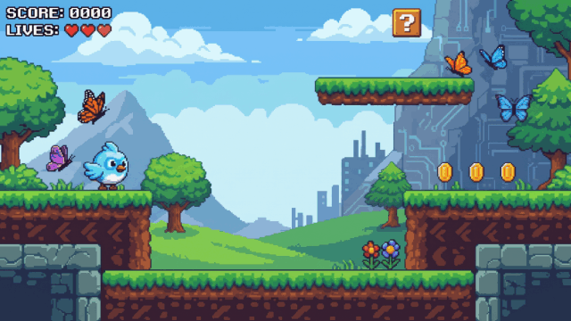

# shader_transitions — example gallery

A live demo of every transition in the [`shader_transitions`](https://pub.dev/packages/shader_transitions) package, with sliders and color swatches that let you configure each option before triggering the transition.



## Run it

```sh
cd example
flutter pub get
flutter run
```

> If you've edited any `.frag` file in `../shaders/`, run `flutter clean && flutter pub get` first — Flutter caches compiled shader assets and hot reload won't pick up GLSL changes on its own.

Requires Flutter 3.38+: the iOS runner uses the UIScene lifecycle, which apps built against the iOS 27 SDK must adopt.

## On-device render tests

Unit tests can't load fragment shaders, so [`integration_test/shader_render_test.dart`](integration_test/shader_render_test.dart) runs on a real GPU backend (Impeller/Metal on iOS). It freezes each transition at a known progress, reads the rendered pixels back, and checks the mask geometry. It also checks the iOS back swipe mid-drag on the real mask, then drives the gallery through a push/pop of every transition.

```sh
cd example
flutter test integration_test -d <device-or-simulator-id>
```

## On a physical iPhone

The iOS bundle ID is `com.johnpatrickprieto.shadertransitions.example`. With the device connected (unlocked, Developer Mode on, computer trusted):

```sh
flutter run -d <iphone-id>                      # the gallery
flutter test integration_test -d <iphone-id>    # the render tests
```

Flutter signs with the Apple Development identity in your keychain automatically. If you're not on the owner's team, open `ios/Runner.xcworkspace`, select the Runner target → Signing & Capabilities, pick your team, and change the bundle ID to one you own.

## Layout

- **≥ 720 px wide** → two-column master/detail. Type list on the left, live editor on the right.
- **< 720 px wide** → tapping a type pushes an editor page; back button returns to the list.

The breakpoint lives in [`lib/screens/gallery_screen.dart`](lib/screens/gallery_screen.dart) as `wideLayoutBreakpoint`.

## What's interactive

In the editor pane (or page) you can tweak:

- **Direction** — full dropdown over all 8 `SweepDirection` values; hidden for the circle iris.
- **Transition duration** — slider, 100–2000 ms.
- **Size** — slider, 1–100 px. Cell size for diamond, feather width for wipe; hidden for circle.
- **Cover color** — None / Black / White / Indigo / Red swatches. Picking a color flips the transition into the three-phase cover flow.
- **Cover duration** — slider, 0–3000 ms. Appears once a cover color is set; this is the hold time between the cover wipe-in and the page wipe-out, clamped internally to ≤ 75% of `transitionDuration`.

The **Test transition** button at the bottom pushes a `DestinationScreen` with the current config so you see the full forward animation; the back arrow plays the reverse. On iOS and macOS you can also swipe from the left edge to scrub the transition backwards under your finger.

## Key files

- [`lib/main.dart`](lib/main.dart) — `ShaderTransitions.preload()` before `runApp`, then mounts `GalleryScreen`.
- [`lib/screens/gallery_screen.dart`](lib/screens/gallery_screen.dart) — type list, layout switching, the `TransitionEditor` widget that builds each `ShaderTransition` (e.g. `ShaderTransition.diamond(...)`, `ShaderTransition.wipe(...)`).
- [`lib/screens/destination_screen.dart`](lib/screens/destination_screen.dart) — the page each transition pushes into. Shows the live config and a button to pop back (playing the reverse animation).

## README GIFs

The GIFs in [`../screenshots/`](../screenshots/) are rendered by [`tool/readme_gifs_test.dart`](tool/readme_gifs_test.dart) — see [`../screenshots/README.md`](../screenshots/README.md).

---

Built by [John Patrick Prieto](https://johnpatrickprieto.com)
